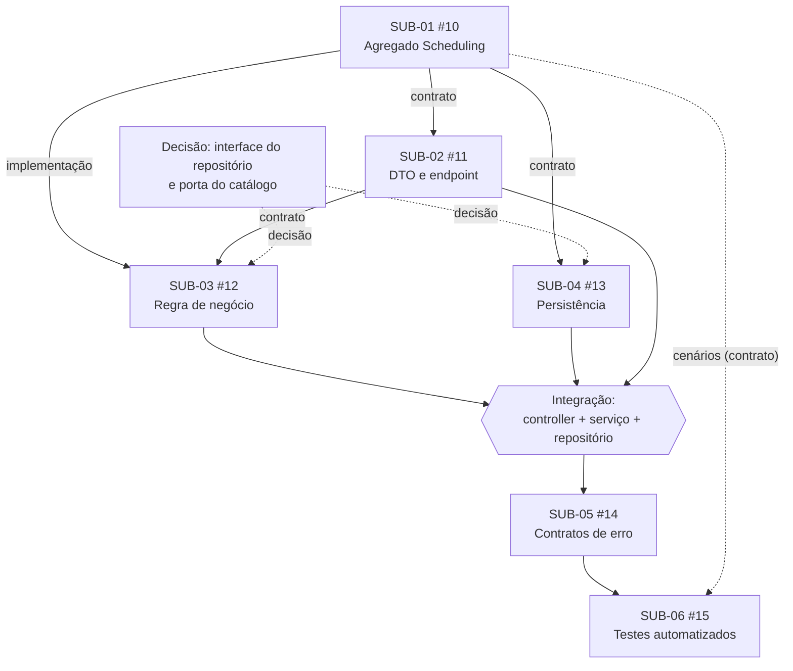

# Planejamento Operacional e Priorização do Desenvolvimento — UC01 Solicitar Agendamento

**Projeto:** Conecta Pro Services — Desenvolvimento de Sistemas Corporativos

**Equipe:** Guilherme Campos Feuser, Layssa Rodrigues Alves, João Pedro Zanette Sartori

**Repositório:** https://github.com/ConectaProServices/conecta-pro-services

**Data:** 08/11/2026

**Issues do UC01**: principal **#01**; SUB-01 **#10**, SUB-02 **#11**, SUB-03 **#12**, SUB-04 **#13**, SUB-05 **#14**, SUB-06 **#15**.

---

## 1. Matriz de Priorização Técnica

Escala: **A** = alta, **M** = média, **B** = baixa. Em *Risco* e *Complexidade*, quanto maior, mais atenção; em *Valor*, *Impacto* e *Disponibilidade*, quanto maior, melhor.

| Sub-Issue | Dependências (o que produz para os outros) | Valor | Risco técnico | Complexidade | Disponibilidade | Impacto ao concluir | Leitura |
| :--- | :--- | :---: | :---: | :---: | :---: | :---: | :--- |
| **SUB-01** (#10) Agregado `Scheduling` | Produz o contrato do domínio (campos, status `PENDING`, cálculo de `endsAt`) usado por SUB-02, 03, 04 e 06 | A | M | A | A (Guilherme, perfil mais completo) | A: desbloqueia todas as demais | **Atenção inicial** |
| **SUB-02** (#11) DTO e endpoint | Produz o contrato de entrada (payload e rota) usado por SUB-03, 05 e 06 | M | B | M | A (Layssa) | M | Avança em paralelo logo que o contrato de SUB-01 estiver acordado |
| **SUB-03** (#12) Regra de negócio | Consome SUB-01 e SUB-02; produz o comportamento central e as exceções usadas por SUB-05 e SUB-06 | A | **A**: antecedência de 24h, sobreposição de agenda (INV-1), RN03, RN05, ordem das validações | A | M (João concentra regra e erro) | A | Alto valor e risco, mas **depende** de SUB-01 e SUB-02; começa após o contrato |
| **SUB-04** (#13) Persistência | Consome SUB-01; implementa o contrato do repositório usado por SUB-03 | A | **A**: PostgreSQL, consistência sob concorrência (INV-1) e mapeamento ORM | A | M | A | Risco a mitigar cedo, com o contrato do repositório acordado |
| **SUB-05** (#14) Exceções e contratos de erro | Consome SUB-02, 03 e 04 | M | B | M | A | M | Depende do fluxo principal; fica para depois |
| **SUB-06** (#15) Testes automatizados | Consome SUB-01 a 05 para executar; os cenários podem ser definidos antes | M | B | M | M (Guilherme também é gargalo em SUB-01) | M: valida o conjunto | Definição de cenários em paralelo; execução ao final |

### Decisão de priorização

**Recebe atenção inicial: SUB-01 — Modelar e validar o agregado `Scheduling` (#10).**

Justificativa técnica:
1. **Dependência e impacto:** é a única Sub-Issue sem pré-requisito estrutural e todas as outras dependem do seu contrato (campos, status e cálculo de `endsAt`). Concluí-la, ou ao menos fechar o contrato, libera SUB-02, SUB-03, SUB-04 e a definição de cenários da SUB-06.
2. **Valor:** representa o ciclo de vida da solicitação no domínio, base de RN01 e INV-1.
3. **Risco:** é de complexidade alta, mas de risco técnico moderado. Antecipá-la reduz o risco das demais, porque o erro de modelagem se propaga a todas as Sub-Issues.
4. **Disponibilidade:** Guilherme, responsável técnico, tem o perfil mais adequado (NestJS, PostgreSQL, modelagem de domínio).

**Prioridade ≠ ordem de execução.** SUB-03 e SUB-04 têm risco técnico maior, mas não são as primeiras: dependem de contratos que a SUB-01 produz. Por isso o risco delas é tratado cedo, ao **acordar os contratos** (ver §2), e não ao começar a implementação antes da hora.

---

## 2. Mapeamento de Dependências e Paralelismo

### 2.1 Classificação das dependências

| Relação | Tipo | Justificativa técnica |
| :--- | :--- | :--- |
| SUB-01 → SUB-02 | **Contrato** | O DTO e o endpoint só precisam dos campos e tipos do agregado (`customerId`, `serviceId`, `professionalId`, `startsAt`), não do código funcionando |
| SUB-01 → SUB-03 | **Implementação** | A regra de negócio instancia e usa o comportamento concreto do agregado (status `PENDING`, cálculo de `endsAt`) |
| SUB-02 → SUB-03 | **Contrato** | O serviço recebe a entrada definida pelo DTO; basta a assinatura |
| Interface do repositório → SUB-03 e SUB-04 | **Decisão** | SUB-03 usa o repositório por abstração e SUB-04 o implementa. A interface precisa ser formalizada antes de ambos |
| Porta do catálogo de serviços → SUB-03 | **Decisão** | A regra "serviço existe no catálogo" depende de como o catálogo é acessado (interface) |
| SUB-01 → SUB-04 | **Contrato** | O mapeamento ORM precisa dos atributos do agregado |
| SUB-03 + SUB-04 | **Integração** | Serviço e repositório concreto precisam ser conectados para validar a persistência ponta a ponta |
| SUB-02 + SUB-03 | **Integração** | Controller e serviço precisam ser conectados para o fluxo HTTP |
| SUB-02, 03, 04 → SUB-05 | **Contrato** + **Implementação** | O formato de erro depende das exceções lançadas pela regra e das falhas da persistência |
| SUB-01 a 05 → SUB-06 | **Integração** | Testes E2E exigem o fluxo estável; os **cenários** podem ser definidos antes (contrato) |

> A matriz formal `01-06` registra SUB-04 dependendo de SUB-03. Mantemos essa relação para a **integração**. A análise acima refina que, com a interface do repositório formalizada, SUB-03 e SUB-04 podem avançar em paralelo em partes diferentes e só se encontram na integração. Uma simples relação temática não é dependência.

### 2.2 Diagrama de dependências

### 2.3 Paralelismo viável

1. **Início:** apenas SUB-01 está livre de pré-requisitos.
2. **Assim que o contrato do agregado estiver acordado** (campos, tipos e status `PENDING`, registrado na #10), podem andar em paralelo:
   - **SUB-02** (Layssa): DTO e endpoint, apenas contrato de entrada;
   - **definição dos cenários de teste da SUB-06**, sem executar;
   - **esboço do mapeamento da SUB-04**, após a interface do repositório estar formalizada.
3. **Após SUB-01 e SUB-02 estáveis:** **SUB-03** (João) e **SUB-04** (Layssa) em paralelo, por trabalharem em arquivos distintos (serviço × repositório/ORM), encontrando-se na integração.
4. **Sequencial por natureza:** a execução plena da regra de negócio (SUB-03), a integração, a SUB-05 e a execução dos testes E2E.

**Paralelismo não significa ausência de integração:** há dois pontos de integração (controller + serviço e serviço + repositório), tratados em PR e revisão separados.

---

## 3. Impedimentos, Política de WIP e Mitigação de Gargalos

### 3.1 Dependência

**Dependências previstas (não são impedimentos):** a cadeia SUB-01 → SUB-02 → SUB-03 → SUB-04 → SUB-05 → SUB-06 é uma relação técnica planejada e controlada.

### 3.2 Minuta de comentário de impedimento (a postar na Issue afetada)

**Impedimento — [SUB-01] Modelar e validar o agregado Scheduling (#10)**

| Campo | Registro |
| :--- | :--- |
| Issue afetada | #10 [SUB-01] (e, por dependência, #11 [SUB-02]) |
| Impedimento identificado | A revisão humana formal (DoR-10) ainda não foi registrada; a Issue não pode ser promovida a `Ready` |
| Impacto | O desenvolvimento não pode ser iniciado nem o contrato do agregado liberado para SUB-02, SUB-03 e SUB-04 |
| Decisão necessária | Aprovar (ou pedir ajustes à) especificação e critérios de aceite da Issue |
| Responsável | Layssa Rodrigues Alves (revisora designada) |
| Próxima ação | Registrar comentário de aprovação na #10; se aprovada, mover para `Ready` |

### 3.3 Política de WIP

**Limite: no máximo 3 Issues simultâneas em `In Progress`**, começando com 2 até o contrato da SUB-01 estar acordado.

Regras da política:
- **Concluir antes de abrir:** só puxa nova Issue quando há vaga no limite e as dependências estão satisfeitas (*stop starting, start finishing*).
- **Não é "uma Issue por pessoa":** o limite é da equipe; uma pessoa pode revisar enquanto outra implementa.
- **Issues em `In Review` contam como trabalho em aberto** até serem aprovadas, evitando acumular revisões.
- O limite é revisado na reunião de coordenação se um gargalo aparecer.

Justificativa para 3: a equipe tem 3 integrantes e a análise de paralelismo mostra, no máximo, 3 trilhas realmente independentes (por exemplo SUB-02, SUB-03 e SUB-04 após o contrato). O limite é compatível com a complexidade (3 Sub-Issues de complexidade alta) e deixa folga para a revisão cruzada. Com mais de 3, as dependências pendentes cresceriam e a previsibilidade cairia. O início com 2 reflete que SUB-01 bloqueia as demais.

### 3.4 Gargalos e mitigação

| Gargalo | Mitigação |
| :--- | :--- |
| **Guilherme** é responsável pela SUB-01 (crítica) e pela SUB-06, e revisa SUB-03 e SUB-04 | Fechar primeiro o **contrato** da SUB-01 (curto) para liberar os demais; SUB-06 começa só na definição de cenários, e a revisão de SUB-04 pode ser compartilhada com João |
| Revisões acumuladas | Limite de WIP conta `In Review`; revisão cruzada com revisores distintos (já definida em `02-03`) |
| Decisões de contrato indefinidas | Registrar a decisão em comentário na Issue correspondente antes de iniciar SUB-03 e SUB-04 |

---

## 4. Ata da Reunião de Coordenação

**Data/hora:** 08/11/2026 — **Duração:** 15 minutos — **Formato:** online
**Participantes:** Guilherme Campos Feuser, Layssa Rodrigues Alves, João Pedro Zanette Sartori

**Pauta:** (1) qual Sub-Issue é puxada primeiro; (2) quem trabalha nela e nas tarefas paralelas; (3) pendências de especificação ou DoR; (4) registrar decisões.

**Decisões** (proposta preparada para a reunião; **ajuste ao que foi realmente decidido**):

| # | Decisão | Responsável | Prazo |
| :--- | :--- | :--- | :--- |
| 1 | **SUB-01 (#10) é puxada primeiro**, por produzir o contrato do domínio e desbloquear as demais | Guilherme | 15/11 |
| 2 | Registrar o contrato do agregado (campos, tipos, status `PENDING`, cálculo de `endsAt`) em comentário na #10 **antes** de iniciar SUB-02 | Guilherme | 15/11 |
| 3 | **SUB-02 (#11)** avança em paralelo, sobre o contrato acordado | Layssa | após decisão 2 |
| 4 | Definir os cenários de teste da SUB-06 sem executá-los | Guilherme / João | após decisão 2 |
| 5 | Formalizar a interface do repositório e a porta do catálogo de serviços antes de SUB-03 e SUB-04 | Guilherme (arquitetura) | antes de iniciar SUB-03/04 |
| 6 | Adotar WIP máximo de 3, iniciando com 2 | Equipe | imediato |

---

## 5. Comentário publicado na Issue principal

Link: [[[UC01] Solicitar Agendamento](https://github.com/ConectaProServices/conecta-pro-services/issues/1#issue-6030215086)]

---

## 6. Verificação dos critérios de avaliação

| Critério | Onde está atendido |
| :--- | :--- |
| Justificativa técnica da priorização | §1 |
| Compreensão de dependências (contrato × implementação) | §2.1 |
| Paralelismo viável | §2.3 |
| Dependência × impedimento | §3.1 |
| Limite de WIP realista | §3.3 e §3.4 |