# Relatório de Preparação e Governança de Repositório para o Primeiro Slice

**Disciplina:** Desenvolvimento de Software DSC 2026/1
**Projeto:** Sistema de Agendamento de Serviços (Salão, Clínica, Oficina)

---

## 1. Identificação do sistema e do primeiro slice
Esta seção sintetiza o projeto e o recorte escolhido para o primeiro slice, baseando-se no conhecimento consolidado anteriormente.

| Elemento | Informação do projeto | Origem na documentação anterior |
| :--- | :--- | :--- |
| **Sistema** | Sistema de Agendamento de Serviços (Marketplace genérico para pequenos prestadores que sofrem com conflitos de horários e *no-shows*). | Blueprint e Modelagem Conceitual. |
| **Caso de Uso** | UC01 - Solicitar Agendamento (O Cliente busca um serviço e reserva um horário garantido). | Blueprint do Primeiro Slice. |
| **Regra central** | RN01 (Antecedência mínima de 24h) e INV-1 (Proteção síncrona contra *overbooking* / conflito de horários). | Regras de Negócio e Invariantes do Domínio. |
| **Conceito principal do domínio** | Entidade `Agendamento` (coordenando a regra de tempo) e `Agenda` (garantindo a disponibilidade). | Modelagem de Domínio e Contextos. |
| **Limites do primeiro slice** | **Entra:** Recebimento da requisição, orquestração, snapshot do serviço, bloqueio da agenda e persistência. **Não entra:** Aprovação, *timeout*, disparo de e-mails, pagamento. | Definição de Escopo do Blueprint. |

---

## 2. Organization e repositório
O repositório do projeto foi criado dentro de uma *Organization* dedicada para garantir que o código seja um ativo do projeto, e não dependente da conta pessoal de um único integrante.

*   **Link da Organization:** [https://github.com/ConectaProServices]
*   **Link do Repositório:** [https://github.com/ConectaProServices/conecta-pro-services.git]

**Justificativa:** O repositório é considerado um ativo do projeto porque a *Organization* garante continuidade. Se um membro sair da equipe, o código, o histórico de *Issues*, os *Pull Requests* e as configurações de CI/CD permanecem intactos sob a posse da organização, permitindo gestão de acessos profissional e centralizada.

---

## 3. README e documentação inicial
A base documental do repositório foi configurada para dar contexto a qualquer novo desenvolvedor.

*   **README.md:** [https://github.com/ConectaProServices/conecta-pro-services/blob/main/README.md] - Contém o propósito do sistema, tecnologias previstas e o status atual.
*   **docs/visao-geral.md:** [https://github.com/ConectaProServices/conecta-pro-services/blob/main/docs/visao-geral.md] - Consolida as fronteiras e regras do sistema.
*   **.gitignore:** [https://github.com/ConectaProServices/conecta-pro-services/blob/main/.gitignore] - Configurado para ignorar arquivos desnecessários (como dependências e artefatos de build) e dados sensíveis.

**Análise:** Sim, alguém de fora da equipe consegue compreender o sistema e o estágio atual. Os documentos foram redigidos de forma objetiva, deixando claro que o projeto está na fase de "preparação arquitetural para o primeiro slice" e diferenciando claramente as tecnologias que estão *previstas* daquelas que já estão *configuradas*, evitando falsas expectativas de que a API já está em execução.

---

## 4. Registro das operações Git e commits
Abaixo está o registro da execução prática do fluxo do Git para a criação da documentação inicial.

| Ação real | Evidência ou referência | O que demonstra |
| :--- | :--- | :--- |
| **Trabalho local / git status** | `Untracked files: README.md, docs/, .gitignore` | O repositório local reconhece os novos arquivos criados, mas eles ainda não estão sendo rastreados pelo Git. |
| **Preparação das alterações / staging** | `git add .` seguido de `git status` (arquivos ficam verdes / *Changes to be committed*) | Demonstra a seleção dos arquivos que farão parte da próxima unidade lógica de mudança (o commit). |
| **Commit de documentação** | [https://github.com/ConectaProServices/conecta-pro-services/commit/6995a27a04cd9b5e9352bead782bce4ec2aa6d0e] | Cria um "retrato" do estado atual atrelado a uma mensagem semântica: `docs(project): adiciona visao geral e estrutura inicial`. |
| **Publicação no remoto** | [https://github.com/ConectaProServices/conecta-pro-services/commit/cf965e18ca5ed3e57eb5279c2171a05c88513544] | (`git push origin main`) Envia o histórico local para o servidor do GitHub, sincronizando as bases. |

**Diferença conceitual:**
*   **Editar arquivo:** Altera o arquivo no disco rígido (Working Directory).
*   **`git add`:** Move a alteração para a *Staging Area*, preparando-a para ser salva.
*   **`git commit`:** Salva o pacote preparado no histórico local do repositório, com um autor e mensagem.
*   **`git push`:** Transmite esses commits locais para o repositório remoto (GitHub), compartilhando com a equipe.

---

## 5. Membros, Teams e permissões
O princípio do menor privilégio foi aplicado na *Organization*.

| Membro ou Team | Função | Acesso concedido | Justificativa |
| :--- | :--- | :--- | :--- |
| **Admin/Owner** | Gestão da Organização | *Admin* | Necessário para configurar repositórios, gerenciar *secrets* e definir regras de proteção de branch (*Branch Protection Rules*). |
| **Team: Backend Devs** | Implementação | *Write* | Permite clonar, criar branches, fazer commits e abrir PRs, mas impede deletar o repositório ou alterar configurações críticas. |
| **Revisores Externos** | Avaliação/Auditoria | *Read* | Podem ler o código e comentar em PRs, mas não podem alterar o histórico do projeto. Garante segurança e controle. |

---

## 6. Issue e critérios de aceitação
Uma *Issue* real foi criada para rastrear a implementação futura do UC01.

*   **Link da Issue:** [https://github.com/ConectaProServices/conecta-pro-services/issues/1]
*   **Título:** `[FEAT] Implementar Solicitação de Agendamento (UC01)`
*   **Critérios de Aceitação planejados:** (1) Endpoint recebe requisição válida; (2) Sistema valida antecedência de 24h; (3) Sistema bloqueia horário na agenda; (4) Transação é revertida em caso de conflito simultâneo.

**Por que a Issue é uma unidade de trabalho e não substitui a especificação funcional?**
A especificação funcional (Blueprint) documenta *o que* o sistema faz e as regras imutáveis do domínio. A *Issue*, por outro lado, gerencia *o esforço de implementação*. Ela tem estado (Aberta, Em andamento, Concluída), responsáveis assinalados, discussões temporárias sobre bloqueios de código e serve para conectar a branch e os PRs. A Issue morre quando é fechada; a especificação permanece viva.

---

## 7. Branch e propósito
Uma branch específica foi criada a partir da `main` atualizada para isolar o trabalho do primeiro slice.

*   **Comandos executados:** `git pull origin main` -> `git switch -c feat/issue-1-solicitar-agendamento`.
*   **Link da Branch:** [https://github.com/ConectaProServices/conecta-pro-services/tree/feat/issue-1-solicitar-agendamento]
*   **Propósito:** Esta branch foi preparada para receber, no futuro, o código do *Controller*, *Application Service* e do *Domínio* referentes à criação da reserva. Isolá-la garante que a `main` não receba código quebrado ou incompleto durante os dias de desenvolvimento.

---

## 8. Planejamento do Pull Request
Quando a implementação do *Slice* estiver pronta na branch, um PR será aberto.

**Conteúdo planejado para o PR:**
1.  **Objetivo:** Implementar o fluxo de criação de agendamentos pendentes.
2.  **Issue relacionada:** `Closes #1`.
3.  **Decisões relevantes:** Explicação sobre como a INV-1 foi garantida na mesma transação.
4.  **Validação:** Descrição dos testes realizados (ex: envio de payload via HTTP).
5.  **Atenção na revisão:** Pedido para o revisor focar na classe de Domínio para garantir que a RN01 (24h) não vazou para o *Application Service*.

**Por que `push` não equivale a integrar na `main`?**
O `push` apenas envia a branch isolada para o servidor. O *Pull Request* é a etapa de aprovação qualitativa: ele roda as esteiras de CI (testes automatizados), exige auditoria visual humana (Code Review) e protege a `main` de bugs e quebras de arquitetura. É uma barreira de qualidade.

---

## 9. Planejamento do Code Review
O Code Review utilizará o seguinte checklist enxuto para o futuro revisor:

| Dimensão | Pergunta de revisão relacionada ao primeiro slice |
| :--- | :--- |
| **Domínio** | A regra central (RN01 - 24h antecedência) está protegida dentro da Entidade `Agendamento`, sem vazar para Controllers? |
| **Aplicação** | O *UseCase* apenas orquestra chamadas e portas, sem conter lógicas de negócio ou consultas SQL (ORM)? |
| **Arquitetura** | O bloqueio síncrono da Agenda respeitou as interfaces (portas) definidas no Blueprint? |
| **Qualidade** | Os nomes refletem a linguagem ubíqua (ex: `JanelaDeTempo` em vez de `TimeSlot`)? |
| **Validação** | A evidência em anexo comprova que o sistema recusa agendamentos no passado? |

**Exemplo de Comentário Construtivo (Code Review):**
*   *Comentário do Revisor:* "Oi! Notei na linha 45 do `SolicitarAgendamentoUseCase` que você está fazendo o cálculo de data (`if data < 24h throw Error`). Isso é uma regra de negócio e deveria estar encapsulada dentro da Entidade/Factory `Agendamento`. Podemos mover isso para proteger o domínio?"
*   *Resposta esperada do Autor:* O autor não deve levar para o lado pessoal. Deve analisar a pontuação, mover a lógica para a classe correta, fazer um novo commit na mesma branch informando a correção, e responder: "Bem observado! Movi a validação para o método construtor da Entidade. Pode verificar novamente, por favor?".

---

## 10. Rastreabilidade em Mermaid
Este diagrama ilustra a governança e a rastreabilidade, diferenciando o que já existe (linhas contínuas) do que está planejado para o futuro (linhas tracejadas).

```mermaid
flowchart LR
    %% Existentes
    D[Documentação Anterior\nBlueprint e Domínio] --> UC[UC01 - Solicitar Agendamento]
    UC --> DOC[docs/visao-geral.md\nno Repositório]
    DOC --> I[Issue #1\nCriada no GitHub]
    I --> B[Branch\nfeat/issue-1...]
    
    %% Futuros
    B -.-> C[Commits de\nImplementação Futuros]
    C -.-> PR[Pull Request\nFuturo]
    PR -.-> R[Code Review\nFuturo]
    R -.-> M[Merge na Main\nFuturo]

    classDef existing fill:#d4edda,stroke:#28a745,stroke-width:2px;
    classDef future fill:#fff3cd,stroke:#ffc107,stroke-width:2px,stroke-dasharray: 5 5;
    
    class D,UC,DOC,I,B existing;
    class C,PR,R,M future;
```

**Como um futuro desenvolvedor rastreia decisões?**
Se ele não entender o porquê de uma linha de código, ele usará o `git blame` para descobrir o *Commit*. O *Commit* o levará ao *Pull Request*. O *PR* estará lincado à *Issue*. A *Issue* remeterá ao `docs/visao-geral.md` e ao Blueprint, que explicam o objetivo do Ator e a Invariante de Negócio original.

---

## 11. Revisões e pendências de governança
Não foram identificadas contradições críticas nesta etapa, pois o Blueprint anterior já havia deixado os limites do primeiro slice muito claros.

| Artefato ou decisão anterior | Revisão identificada | Justificativa | Impacto futuro |
| :--- | :--- | :--- | :--- |
| **Blueprint do Slice** | Nenhuma alteração estrutural. | Os limites do Caso de Uso (UC01) continuam se adequando perfeitamente à governança de repositório montada. | Mantém o plano de implementação intacto. |
| **.env.example** | Adição posterior (Pendência). | O arquivo `.env.example` ainda não contém as variáveis de banco de dados, pois o framework ainda não foi inicializado nesta atividade. | Será atualizado quando o ORM e o PostgreSQL forem configurados futuramente. |

---

## 12. Reflexão crítica
Respostas objetivas às questões levantadas pelo trabalho:

1.  **O que a organização do repositório revelou sobre o estágio real do projeto?** Revelou que o projeto saiu do campo puramente analítico (documentos textuais e PDFs) e estabeleceu uma fundação técnica executável. Ele demonstrou que estamos prontos para receber código, mas sem fingir que o código já existe.
2.  **Qual é a ligação verificável entre o Caso de Uso, a Issue e a branch?** A rastreabilidade nominal. A Issue cita o "UC01", e a branch foi nomeada com o número da Issue e o contexto funcional. Existe uma amarração direta de IDs entre o negócio, o rastreador de tarefas e o controle de versão.
3.  **Por que um commit com mensagem clara é mais útil do que um commit chamado "final"?** Porque o histórico do Git não serve apenas para salvar arquivos, mas para documentar o *raciocínio* temporal do sistema. Um commit "final" não ajuda na auditoria de um bug 6 meses depois; um commit com convenção (`feat: implementa regra de 24h`) contextualiza a mudança.
4.  **Qual risco existe ao manter alterações sem revisão na `main`?** A `main` deve representar sempre o estado estável, funcional e implantável (*deployable*) do sistema. Inserir código não revisado diretamente pode quebrar o sistema inteiro, impactando todos os outros desenvolvedores.
5.  **Que parte do processo de PR/review sua equipe ainda precisará praticar antes da implementação efetiva?** Precisaremos praticar a abstração das críticas técnicas (saber comentar o código e não o autor) e a disciplina de não aprovar PRs apressadamente apenas para cumprir prazos.
6.  **O que precisa estar pronto para que outra pessoa continue o desenvolvimento sem depender de explicações informais?** O `README.md` detalhado, a documentação em `docs/visao-geral.md`, as Issues com critérios de aceitação claros, e um histórico de *commits* semântico e rastreável. Tudo isso forma o contexto assíncrono do projeto.

---

## 13. Apêndice de uso de IA, quando aplicável

*   **Ferramenta utilizada:** Google Gemini Pro.
*   **Finalidade:** Apoio metodológico para organizar a estrutura do Markdown e garantir a formatação completa solicitada pelas instruções do trabalho.
*   **Principais sugestões e verificações:** A IA estruturou o diagrama Mermaid com distinção visual de cores para os artefatos existentes vs. futuros.
*   **Sugestões rejeitadas:** A IA foi impedida de gerar códigos, comandos de migrações ou simular repositórios reais no GitHub, limitando-se a preparar o modelo conceitual.
*   **Reflexão independente:** O uso da IA não substituiu a compreensão de por que proteger a *main* ou de como vincular a branch à issue; apenas acelerou a redação dessas lógicas em formato de relatório técnico estruturado.